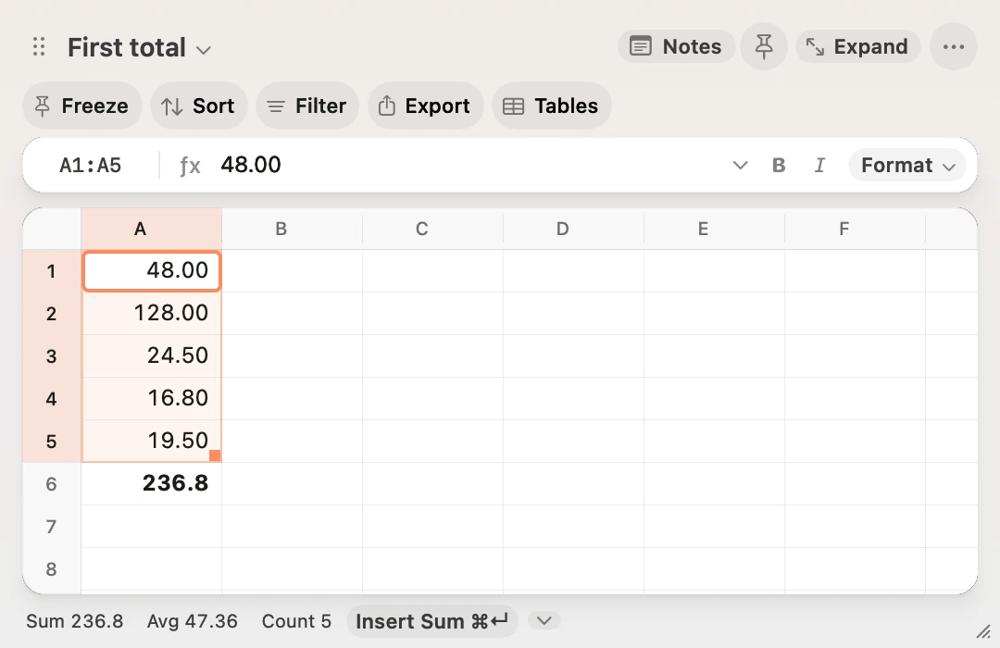
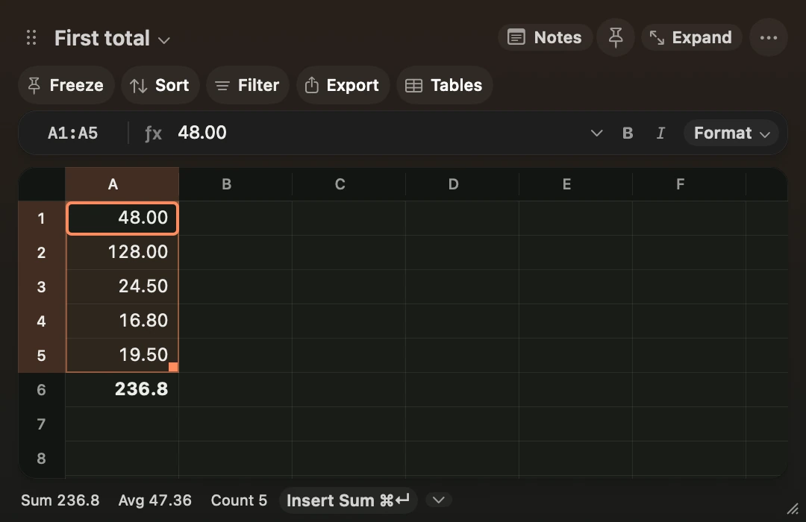

**Scratch is a floating spreadsheet for macOS. Its menu bar icon and global shortcut bring up the same workbook from any app.**

## Open Scratch

Scratch is in local preview. If you have a copy of the source, run `make run` from its folder. The build needs macOS 14 or later and Swift 6.

Click Scratch’s menu bar icon or press ⌥ Space. Press Escape on the grid to dismiss it. Open it again to resume at the same selection. The pin beside Notes keeps the grid visible when you switch apps.

## Add five numbers

1. Type a number and press Return. Repeat for five consecutive rows in column A.
2. In A6, type `=su` and press Tab to complete `=SUM(`.
3. Press Shift+Up five times to select A1:A5. Press Return to show the total.
4. Change one of the inputs. The total updates automatically.

<figure class="scratch-media">
<video class="scratch-light" controls muted loop playsinline preload="none" aria-label="Select five values, enter SUM in A6 and extend the reference to A1:A5 with Shift and Up." poster="/docs/first-total-light.webp" width="1080" height="700">
<source src="/docs/first-total-demo-light.mp4" type="video/mp4">
</video>

<video class="scratch-dark" controls muted loop playsinline preload="none" aria-label="Select five values, enter SUM in A6 and extend the reference to A1:A5 with Shift and Up." poster="/docs/first-total-dark.webp" width="1080" height="700">
<source src="/docs/first-total-demo-dark.mp4" type="video/mp4">
</video>

</figure>

Use ⇧⌘N to create a sheet and ⌘K to [find a sheet by name](/docs/shortcuts#switch-sheets). Each sheet has its own grid, notes and column widths. Scratch autosaves the workbook locally. **Delete Current Sheet** removes a sheet from the workbook view. **Restore Deleted Sheet** recovers it, including its notes, after a restart.

## Change the shortcuts

Click **⋯ → Keyboard Shortcuts** to change the shortcuts for opening Scratch, capturing the clipboard, Notes or the command palette. **Capture Clipboard in New Sheet** is also available from the ⋯ menu and the command palette. [Keyboard Shortcuts](/docs/shortcuts).

## Choose the look and motion

Open **⋯** and choose **Animation Style**. **Natural** is the default. **Snappy** shortens transitions, and **Off** turns them off. The docked Notes pane reveals from its divider. Nearby cell jumps scroll into view, and distant ones land with a short fade. macOS Reduce Motion skips the movement. Scratch uses a solid window background when Reduce Transparency is on.

Turn on **Follow System Accent** in the same menu to use the accent from macOS. Scratch uses a coral accent by default. Formula references have their own colours so you can match the formula to the cells in the grid.
