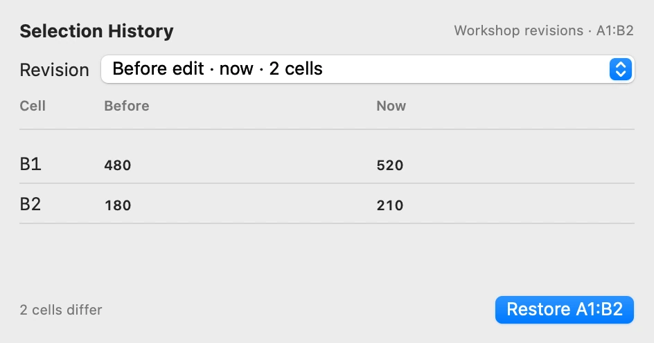
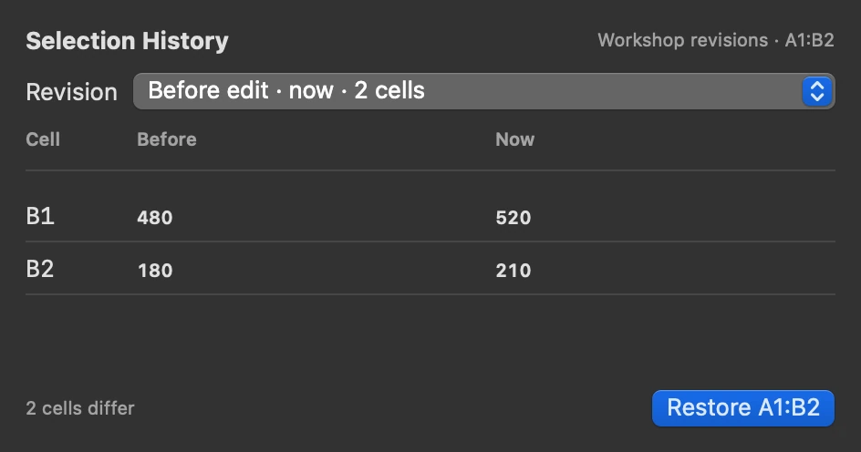

**Select the cells you want to recover and choose Show Selection History from the sheet menu or the command palette.**

## Compare a revision

Pick a revision to see the selected cells that differ from the current sheet. **Before** shows the entries and formatting just before that edit. **Now** shows what is in the grid. Changed entries or formats are emphasised. Formula cells show the expression that will be restored. Hover over the revision time for the exact date and time.

<figure class="scratch-media">

</figure>

## Restore just the range

Enter `10` in A1 and `=A1*2` in B1. Change A1 to `15`, then select A1:B1 and open **Show Selection History**. Choose the revision before the last edit and click **Restore A1:B1**. A1 returns to `10` and B1 recalculates to `20`.

Scratch restores entries and formatting inside the selected range. Cells outside it keep their current entries. Formulas recalculate using the current sheet, including any references outside the range. Press ⌘Z to reverse the restore in one step.

History starts with edits made after installing this build and stays in the workbook on your Mac across launches. Scratch keeps up to 100 recent grid edits per sheet. Large edits can reduce how many older revisions are kept.
