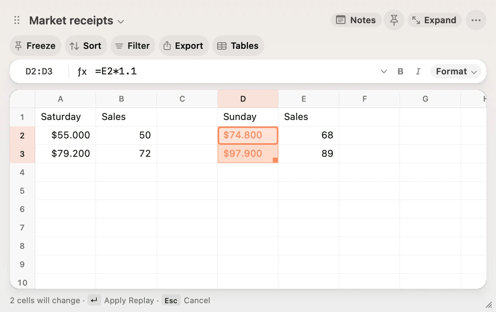
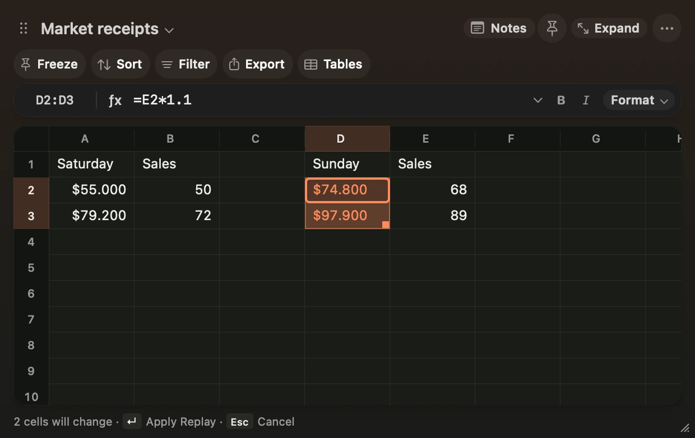

**Open the command palette and choose Start Recording.** Run up to 12 steps, then choose **Save Recording**, type a name and press Return.

Scratch can record **Fill Down**, **Fill Right**, **Clear Cell Contents** and cell formatting commands. You can use their shortcuts, the Format menu or the command palette. The commands take effect as you record them. To discard the recording, choose **Cancel Recording**. Use Undo in the grid to reverse an edit you made while recording.

## Try it on another range

1. Select a column of cells with a formula in the first row. Record **Fill Down**, **Format as AUD** and **Add Decimal Place**.
2. Save the recording as **AUD totals**. Select a different range with its own formula in the first row.
3. In the command palette, choose **Replay AUD totals**. Scratch highlights the cells it would change and shows their resulting text.
4. Press Return to apply the replay as one edit, or Escape to discard the preview. Press ⌘Z to undo the applied replay.

Each step uses the new selection’s contents and formatting. Relative references shift as they do with ordinary Fill Down and Fill Right. Scratch saves named replays on this Mac. Use **Remove Saved Replay** in the command palette to remove one.

<figure class="scratch-media">
<video class="scratch-light" controls muted loop playsinline preload="none" aria-label="Record fill and formatting commands, then preview the changes on the Sunday receipts." poster="/docs/replay-preview-light.webp" width="1240" height="780">
<source src="/docs/replay-demo-light.mp4" type="video/mp4">
</video>

<video class="scratch-dark" controls muted loop playsinline preload="none" aria-label="Record fill and formatting commands, then preview the changes on the Sunday receipts." poster="/docs/replay-preview-dark.webp" width="1240" height="780">
<source src="/docs/replay-demo-dark.mp4" type="video/mp4">
</video>

</figure>
