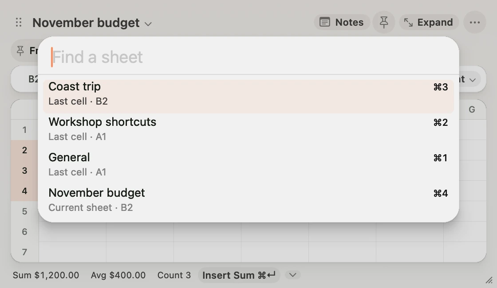
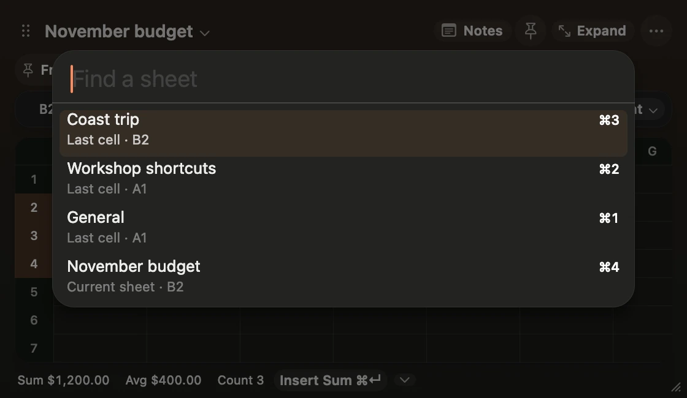
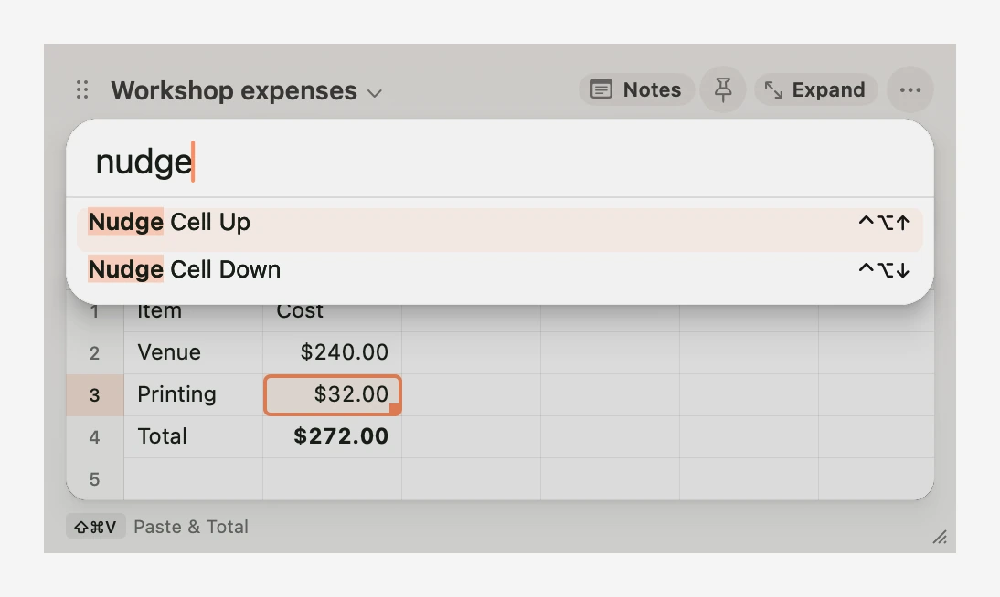
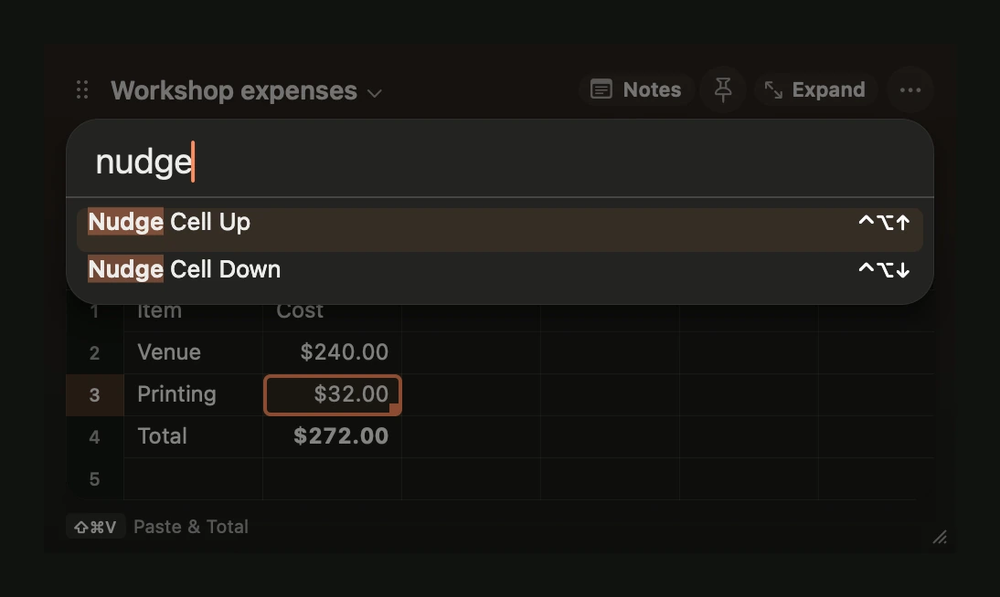
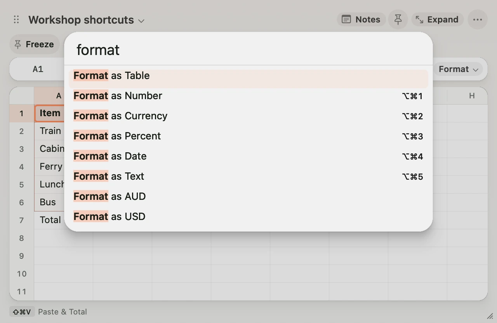
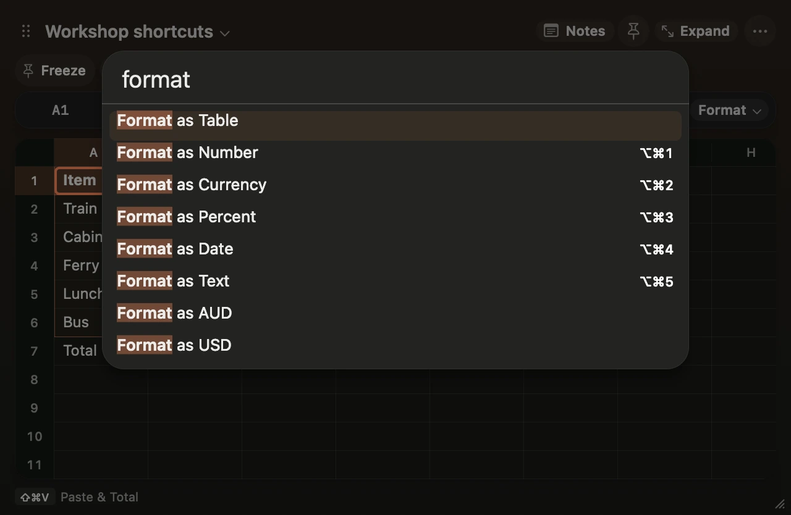

**Click the ⋯ button in Scratch and open Keyboard Shortcuts.** Choose a **Change** command and press the combination you want. Press Escape to cancel, or choose **Reset** in the menu to restore a default.

| Action | Default | Where it works |
| --- | --- | --- |
| Open Scratch | ⌥ Space | From any app |
| Capture Clipboard | ⌥⇧ Space | From any app |
| Show or Hide Notes | ⌘J | In Scratch |
| Command Palette | ⇧⌘P | In Scratch |
| Focus Notes or Grid | ⌥⌘J | In Scratch |
| Send to Obsidian | ⇧⌘J | In Scratch |
| Find a Sheet | ⌘K | In Scratch |
| Next or Previous Sheet | ⌃Tab or ⌃⇧Tab | In Scratch |
| Nudge Cell Up or Down | ⌃⌥↑ or ⌃⌥↓ | On the grid |

If another app intercepts a shortcut, click **Notes** or choose **Command Palette** from the ⋯ menu while you change the binding. For example, try ⌃⌥N for Notes and ⌃⌥P for the palette if those combinations are available on your Mac. Scratch flags conflicts with its own shortcuts.

Open the command palette and type **Freeze**, **Sort Rows**, **Filter Rows** or **Clear Row Filter**. Tab moves through the sort and filter controls. In Sort, adjust **Rows to move** when needed, choose an order, and click **Apply Sort**. In Filter, type to update the results and press Return to keep them. Press Escape to cancel the preview. [Grid and shortcuts](/docs/grid#freeze-rows-and-columns).

Use **Dock Notes Left**, **Dock Notes Right**, **Dock Notes Top**, **Dock Notes Bottom** or **Detach Notes** in the command palette to arrange the workspace from the keyboard. ⌥⌘J also switches focus between the floating windows. [Move or detach panes](/docs/grid#move-or-detach-panes).

Choose **Tables** in the command palette to find a table or its actions. **Create Table from Selection** goes straight to naming. With a cell in a named table selected, **Sort Rows** and **Filter Rows** use that table. [Named tables](/docs/grid#named-tables).

Use **Hide Selected Rows**, **Hide Selected Columns**, **Show All Rows**, **Show All Columns** or **Fit Row Height** in the command palette. Option-drag a row or column header to move it. [Move, hide or resize rows and columns](/docs/grid#move-hide-or-resize-rows-and-columns).

Find **New Workbook**, **Open Workbook**, **Open Default Workbook**, **Archive Current Sheet**, **Import Excel Values** and TSV export in the command palette. [Workbooks and sheet archive](/docs/grid#workbooks-and-sheet-archive).

## Switch sheets

Press ⌘K or choose **Switch Sheet** in the command palette. The last sheets you visited in this workbook appear first, with the cell you left selected on each. Press Return to reopen the first result, or type part of a sheet name. Use the arrows to highlight a result and Escape to return to your current sheet.

Press ⌃Tab to move forward in workbook order or ⌃⇧Tab to move backward. Both wrap around and skip archived sheets. ⌘1 through ⌘9 still jump to sheets in workbook order. Click the sheet title to find actions such as Rename and Export.

<figure class="scratch-media">

</figure>

## Nudge a number or date

Select a cell on the grid and press ⌃⌥↑ or ⌃⌥↓. A number moves by one, a date by one day and a percentage by one percentage point. Hold Shift for ten, one week or ten percentage points.

Dependent formulas update as you hold the key. Release it and press ⌘Z to undo the full adjustment. Select a formula’s input cell to adjust the result. **Nudge Cell Up** and **Nudge Cell Down** are also in the command palette.

<figure class="scratch-media">

</figure>

<figure class="scratch-media">

</figure>
